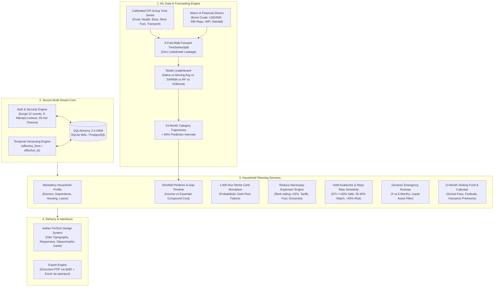

# Parivar Arth
### Family Financial Planning & Intelligence Platform

[](https://www.python.org/)
[](https://streamlit.io/)
[](LICENSE)
[](tests/)

---

## Executive Summary

Household expenses in India rise continuously, yet family budgets rarely adjust in advance. Grocery expenses experience monsoon volatility, private school fees escalate 8–10% annually, healthcare expenses outpace baseline wage growth, and home loan EMIs rise whenever the Reserve Bank of India (RBI) hikes the repo rate.

**Parivar Arth** bridges this gap. It is a multi-user personal financial intelligence platform engineered for Indian households (salaried professionals, gig workers, business owners, and joint families).

**The Core Concept**: *The inflation forecast is the engine; personal planning is the product.* 
Rather than applying generic headline CPI or static current prices, Parivar Arth models category-wise inflation (Groceries, Education, Health, Housing, Transport, Fuel) using machine learning, and compounds those rates onto real household commitments to project future cash flows, detect exact shortfall months, and surface high-impact expense reduction levers.

> **Data Disclosure**: The CPI time-series in this repository is a statistically calibrated synthetic fallback (142 monthly observations from January 2015 to October 2026) calibrated against historical Indian economic averages, and is not a live streaming MoSPI API feed. All forward-looking projections and shortfall dates are statistical estimates intended for educational financial planning.

---

## System Architecture



---

## Technology Stack

The project dependencies are pinned in `requirements.txt`:

| Layer | Package & Version | Purpose |
| :--- | :--- | :--- |
| **User Interface** | `streamlit>=1.35.0` | Modern 8-page multipage web application canvas |
| **Visualizations** | `plotly>=5.20.0` | Interactive charts styled with Aether FinTech visual tokens |
| **Data Processing** | `pandas>=2.1.0`, `numpy>=1.26.0` | Vectorized cash flow matrices and time-series arrays |
| **Machine Learning** | `scikit-learn>=1.4.0` | `TimeSeriesSplit` cross-validation, Random Forest Regressor, and evaluation metrics |
| **Gradient Boosting** | `xgboost>=2.0.0` | Primary production regression model for category inflation forecasting |
| **Statistical Time-Series** | `statsmodels>=0.14.0` | SARIMA benchmark modeling |
| **Database ORM** | `SQLAlchemy>=2.0.0` | Object-relational mapping with SQLite WAL mode and PostgreSQL compatibility |
| **Password Security** | `bcrypt>=4.0.0` | Salted password hashing with 12 work factor rounds |
| **Environment Config** | `python-dotenv>=1.0.0` | Configuration loading from `.env` |
| **PDF Reporting** | `fpdf2>=2.7.0` | Downloadable executive household financial statement |
| **Excel Export** | `openpyxl>=3.1.0` | Multi-tab `.xlsx` financial model generator |
| **External Drivers** | `requests>=2.31.0`, `yfinance>=0.2.35` | Macro market driver fetching utilities |

---

## Machine Learning Pipeline & Verified Benchmark Leaderboard

### Methodology
- **Validation**: 5-fold expanding-window `TimeSeriesSplit` ensuring zero future lookahead leakage.
- **Feature Matrix**:
  - Autoregressive lags: `lag_1`, `lag_2`, `lag_3`, `lag_12`
  - Rolling window statistics: `rolling_mean_3m`, `rolling_std_3m`, `rolling_mean_6m`, `rolling_std_6m`
  - Base effect: `base_effect_12m` (price level from 12 months ago)
  - Seasonal calendar dummies: `is_monsoon` (June–Sept), `is_festival` (Sept–Nov), `is_school_season` (April–June)
  - Exogenous macro drivers (lagged by 1 month): International Crude Oil (INR), USD/INR Exchange Rate, RBI Repo Rate, Rainfall Departure, Wholesale Price Inflation (WPI)
- **Uncertainty Bounds**: 80% residual-based prediction intervals (`compute_prediction_intervals`, confidence level 0.80).

### Walk-Forward Cross-Validation Leaderboard (Real Output from `python scripts/train_models.py`)

The table below reflects the exact output generated by running `python scripts/train_models.py` across all commodity groups (including categories where Naive Baseline outperformed complex models):

| Category | Best Model | Out-of-Fold RMSE | Out-of-Fold MAPE | Improvement vs Naive Baseline |
| :--- | :--- | :--- | :--- | :--- |
| **Headline CPI** | Random Forest | 0.677 | 9.9% | +18.54% |
| **Food and Beverages** | XGBoost | 1.685 | 28.8% | +2.72% |
| **Housing** | Random Forest | 0.676 | 11.5% | +14.25% |
| **Fuel and Light** | Naive Baseline | 1.501 | 27.6% | +0.01% |
| **Transport and Communication** | Naive Baseline | 1.526 | 24.0% | +0.02% |
| **Health** | XGBoost | 0.813 | 8.0% | +21.61% |
| **Education** | XGBoost | 0.720 | 7.5% | +18.82% |
| **Miscellaneous Services** | XGBoost | 0.618 | 8.9% | +21.15% |

*Note: For Fuel & Light and Transport & Communication, the high persistence and frequent external policy adjustments make the Naive Baseline competitive with ML regressors. The pipeline transparently documents these results.*

---

## Core Planning Rules & Verified Parameter Thresholds

All logic in Parivar Arth is verified against explicit code parameters:

- **Security & Authentication** (`core/auth.py`):
  - Password hashing: `bcrypt` with 12 salt rounds
  - Password strength: Minimum 8 characters, at least 1 letter, at least 1 number
  - Account lockout: Triggered after **5 consecutive failed login attempts** (`MAX_FAILED_ATTEMPTS = 5`)
  - Lockout duration: **15 minutes** (`LOCKOUT_DURATION_MINUTES = 15`)
  - Session timeout: **20 minutes of inactivity** (`SESSION_TIMEOUT_MINUTES = 20`)
  - Password reset token validity: **30 minutes** (`RESET_TOKEN_EXPIRY_MINUTES = 30`), single-use SHA-256 hashed token
- **Debt-to-Income (DTI) Thresholds** (`planner/loans.py`):
  - **Safe**: DTI `<= 30.0%`
  - **Watch**: `30.0% < DTI <= 45.0%`
  - **At Risk**: DTI `> 45.0%`
- **Housing / Rent Optimization Ceiling** (`planner/reduction.py`):
  - Flagged when housing expenses exceed **32.0% of monthly income** and are greater than **₹15,000/month**
- **Emergency Runway Rules** (`planner/emergency.py`):
  - Target: **3 months** for dual stable salaried earners
  - Target: **6 months** for single earner households, variable gig income, or dependent family members with chronic medical conditions
  - Liquid assets strictly filtered: Savings bank accounts and Fixed Deposits (FDs) are included; locked provident funds (EPF/PPF) and physical real estate are excluded
- **Budget Distribution Standard** (`core/expense_service.py`):
  - Needs (~50%), Wants (~30%), Savings (~20%)

---

## Application Structure (The 8 Pages)

```text
parivar_arth/
├── .streamlit/
│   ├── config.toml               # Streamlit theme tokens, fonts, and layout options
│   └── secrets.toml.example      # Template for environment variables and secrets
├── app/
│   ├── components/
│   │   ├── auth_forms.py         # Sign In, registration, and password reset form components
│   │   └── formatters.py         # Indian Rupee digit grouping (format_inr) and percentage formatters
│   ├── pages/
│   │   ├── 1_My_Profile.py       # Onboarding wizard, active household plan, versioned edits, audit trail
│   │   ├── 2_Monthly_Tracker.py  # Daily expense logging, 50/30/20 split, CSV import, anomaly banner
│   │   ├── 3_Savings_Advisor.py  # Prioritized savings levers, MoSPI peer benchmarks, goal calculator
│   │   ├── 4_Future_Planner.py   # 24m shortfall timeline, Monte Carlo (1,000 runs), what-if shocks, milestones
│   │   ├── 5_Reduce_Expenses.py  # Practical, dignified reduction levers and interactive reclaim simulator
│   │   ├── 6_Loans_Emergency.py  # Runway status, liquid breakdown, DTI, Avalanche/Snowball, repo shock
│   │   ├── 7_Yearly_Calendar.py  # 12-month outflow matrix, sinking fund allocations, recurring items
│   │   └── 8_Reports.py          # Executive PDF statement (fpdf2) and Excel workbook (openpyxl) exports
│   ├── Login.py                  # Primary entrypoint: authentication gate and household dashboard
│   ├── main.py                   # Forwarder to Login.py for Streamlit Cloud deployment compatibility
│   └── styles.py                 # Shared Aether design tokens, CSS rules, headers, cards, and badges
├── core/
│   ├── auth.py                   # bcrypt hashing, brute-force lockout, session timeouts, SHA-256 tokens
│   ├── db.py                     # SQLAlchemy engine and sessionmaker (SQLite WAL / PostgreSQL)
│   ├── expense_service.py        # Variable expense tracking, 50/30/20 split, z-score anomaly detector
│   ├── models.py                 # Declarative database models (Users, Profiles, Obligations, Loans, etc.)
│   ├── profile_service.py        # Household onboarding and temporal versioning (effective_from / effective_to)
│   └── security.py               # Session touch and tenant isolation
├── data/
│   ├── cpi/                      # Calibrated MoSPI Indian CPI monthly series (2015-2026)
│   ├── models/                   # Serialized production XGBoost models (.json)
│   └── seed/                     # Test data seed definitions
├── docs/
│   ├── benchmark_results.md      # Real printed benchmark results from train_models.py
│   ├── CHANGES_FOR_REPORT.md     # Code verification audit and claim discrepancies table
│   └── PROJECT_REPORT.md         # Academic project report documentation
├── ml/
│   ├── data_sources/
│   │   ├── base.py               # Base class for data sources
│   │   ├── market_macro.py       # Macro drivers (Brent crude, USD/INR, RBI repo rate)
│   │   └── mospi_cpi.py          # CPI category indices and calibrated synthetic fallback
│   ├── evaluate.py               # Metrics calculation (RMSE, MAE, MAPE, SMAPE) and 80% prediction intervals
│   ├── explain.py                # Feature importance extraction and economic narrative generator
│   ├── features.py               # Lags (1, 2, 3, 12), rolling statistics, and seasonal festival flags
│   ├── forecast.py               # 24-month forward category projection engine
│   ├── pipeline.py               # Data harmonization and validation pipeline
│   └── train.py                  # Walk-forward cross validation and multi-model trainer
├── planner/
│   ├── emergency.py              # Dynamic emergency fund rules (3 vs 6 months) and liquid asset filter
│   ├── family_goals.py           # Education milestones and elderly healthcare provision calculator
│   ├── loans.py                  # DTI calculation, Avalanche vs Snowball ranker, repo rate shock simulator
│   ├── montecarlo.py             # 1,000-run Monte Carlo cash flow simulation
│   ├── projection.py             # Compounded monthly expense growth engine
│   ├── reduction.py              # Actionable expense reduction recommendations
│   ├── savings.py                # Prioritized savings levers and MoSPI peer comparison benchmarks
│   ├── shortfall.py              # Shortfall detection engine and 24-month gap timeline
│   └── sinking_funds.py          # Irregular expenditure smoothing and 12-month cashflow matrix
├── reports/
│   ├── excel_generator.py        # Multi-tab OpenXML (.xlsx) workbook generator via openpyxl
│   └── pdf_generator.py          # Executive PDF statement generator via fpdf2
├── scripts/
│   ├── seed_demo_data.py         # Database initialization and ML forecast seeder
│   └── train_models.py           # CLI model training and cross-validation leaderboard runner
├── tests/
│   ├── conftest.py               # Shared test fixtures and in-memory test database
│   ├── test_auth_security.py     # Password hashing, lockout, timeouts, reset flow (8 tests)
│   ├── test_math_hand_verified.py# Hand-verified compounding, shortfall, DTI, repo shock (4 tests)
│   ├── test_planner_logic.py     # Sinking funds, 50/30/20, emergency runway, anomaly (6 tests)
│   ├── test_profile_versioning.py# Conditional rules, temporal versioning, audit trail (3 tests)
│   ├── test_reports.py           # PDF and Excel binary generation validation (2 tests)
│   └── test_time_series_leakage.py# Zero-leakage walk-forward CV, metrics, forecasts (4 tests)
├── pytest.ini                    # Pytest configuration
├── requirements.txt              # Production dependency specifications
└── README.md                     # Comprehensive system documentation
```

---

## Quick Start Guide

### 1. Prerequisites
- Python 3.10, 3.11, 3.12, or 3.13 installed.
- Git installed.

### 2. Clone and Setup Environment
```bash
# Clone the repository
git clone https://github.com/arsalan269/parivar-arth.git
cd parivar-arth

# Create and activate a virtual environment
python -m venv venv

# On Windows:
venv\Scripts\activate

# On macOS/Linux:
source venv/bin/activate

# Install dependencies
pip install -r requirements.txt
```

### 3. Initialize Forecasts and Run Application
```bash
# Optional: run ML training and forecast population
python scripts/train_models.py

# Launch the Streamlit application
streamlit run app/Login.py
```
Open your browser at `http://localhost:8501`.

### 4. User Registration
New households can register immediately on the Sign In page using the **"Register New Family"** tab. All household profiles, expenses, and loans are strictly isolated.

---

## Automated Test Suite

Run the full automated test suite:

```bash
pytest tests/ -q
```

Result: **27 passed** with zero failures or warnings.

---

## License

This project is licensed under the MIT License.
