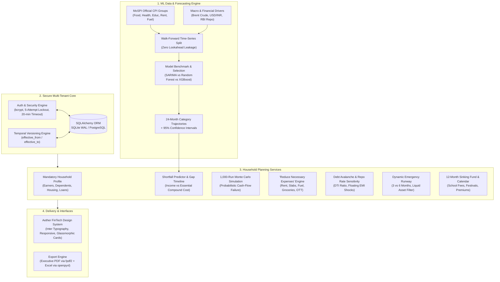

# Parivar Arth
### Family Financial Planning & Intelligence Platform

[](https://www.python.org/)
[](https://streamlit.io/)
[](LICENSE)
[](tests/)

---

## Executive Summary

Household expenses in India rise continuously, yet family budgets rarely adjust in advance. Grocery expenses experience monsoon volatility, private school fees escalate 8-10% annually, healthcare expenses outpace baseline wage growth, and home loan EMIs rise whenever the Reserve Bank of India (RBI) hikes the repo rate.

**Parivar Arth** bridges this gap. It is a multi-user, personal financial intelligence platform engineered specifically for Indian households (salaried professionals, gig workers, business owners, and joint families).

**The Core Idea**: *The inflation forecast is the engine; personal planning is the product.* 
Rather than applying headline CPI or today's static prices, Parivar Arth models category-wise inflation (Groceries, Education, Health, Housing, Transport, Fuel) using machine learning, and compounds those rates onto real household commitments to project future cash flows, detect exact shortfall months, and surface high-impact expense reduction levers.

---

## System Architecture



---

## Technology Stack

| Layer | Technologies Used | Purpose |
| :--- | :--- | :--- |
| **User Interface** | Streamlit (Multipage), Plotly Express & Graph Objects | Aether FinTech design system with Inter typography, soft neutral canvas, and responsive metric cards |
| **Data & ML** | pandas, numpy, scikit-learn, xgboost, statsmodels (SARIMA) | Walk-forward cross-validation, feature engineering, and 24-month autoregressive inflation forecasting |
| **Database** | SQLAlchemy 2.0 ORM, SQLite (WAL mode, Foreign Keys), PostgreSQL-ready | Secure persistence with versioned financial records and cascade deletion |
| **Security & Auth** | bcrypt, Python `secrets`, SHA-256 tokens | Salted password hashing, brute-force lockout, session timeouts, multi-tenant data isolation |
| **Reports** | `fpdf2`, `openpyxl` | One-click exportable executive PDF summaries and multi-tab Excel workbooks |
| **Testing** | `pytest` | 29 comprehensive automated tests across security, time-series, math, and reporting |

---

## Aether FinTech Design System

Parivar Arth utilizes an **Aether-inspired FinTech design system** delivering a minimal, high-contrast dashboard experience:

- **Primary Background (`#F5F7FA`)**: Soft neutral canvas reducing eye fatigue.
- **Card Background (`#FFFFFF`)**: Crisp, elevated card surfaces with subtle borders (`#E9EAF0`) and soft shadows (`0 4px 20px rgba(0, 0, 0, 0.03)`).
- **Primary Accent (`#6C63FF`) & Secondary Accent (`#8B83FF`)**: Electric violet gradients for primary action buttons, active navigation states, and key financial highlights.
- **Soft Purple (`#EFEDFF`)**: Active menu indicators and pill backgrounds.
- **Primary Text (`#202334`)**: High-contrast deep slate for headers and numerical figures.
- **Secondary Text (`#73788C`)**: Muted slate for metadata, labels, and timestamps.
- **Status Indicators**:
  - **Safe** (`#20B486`): Emergency runway >= 6 months, DTI <= 35%, positive cash flow trajectory.
  - **Watch** (`#F4B740`): Emergency runway 3-6 months, DTI 35-45%, minor deficit within 18 months.
  - **At Risk** (`#EF6461`): Emergency runway < 3 months, DTI > 45%, immediate shortfall.
- **Typography**: Inter (SemiBold for headers, Bold for financial figures, Regular for body).
- **Indian Rupee Formatting**: Native Indian numbering format across the UI (`₹1,25,000` rather than `₹125,000`).

---

## Project Directory Structure

```text
parivar_arth/
├── .streamlit/
│   ├── config.toml               # Aether FinTech theme tokens, colors, fonts
│   └── secrets.toml.example      # Template for environment variables and secrets
├── app/
│   ├── components/
│   │   ├── auth_forms.py         # Login, registration, password reset forms
│   │   └── formatters.py         # Indian Rupee digit grouping & percentage formatters
│   ├── pages/
│   │   ├── 1_My_Profile.py       # Versioned household onboarding wizard & audit trail
│   │   ├── 2_Monthly_Tracker.py  # Daily expense logging, 50/30/20 split, z-score anomaly
│   │   ├── 3_Savings_Advisor.py  # Impact-ranked savings levers & goals calculator
│   │   ├── 4_Future_Planner.py   # Shortfall engine, 1,000-run Monte Carlo, what-if stress tests
│   │   ├── 5_Reduce_Expenses.py  # Actionable reduction levers (rent, electricity slabs, fuel)
│   │   ├── 6_Loans_Emergency.py  # DTI tracker, Avalanche vs Snowball, RBI repo rate shock
│   │   ├── 7_Yearly_Calendar.py  # Sinking fund planner & 12-month cash-flow heatmap
│   │   └── 8_Reports.py          # One-click downloadable PDF and Excel exports
│   ├── Login.py                  # Primary entrypoint, auth gate & authenticated dashboard
│   ├── main.py                   # Forwarder to Login.py for Streamlit Cloud compatibility
│   └── styles.py                 # Shared Aether CSS design tokens, card styles, and footers
├── core/
│   ├── auth.py                   # bcrypt hashing, account lockout, SHA-256 reset tokens
│   ├── db.py                     # SQLAlchemy session manager & SQLite/PostgreSQL engine
│   ├── expense_service.py        # Variable expense tracking, 50/30/20 split, z-score anomaly
│   ├── models.py                 # Declarative database models (Profiles, Incomes, Loans, etc.)
│   ├── profile_service.py        # Conditional profile validation & temporal versioning engine
│   └── security.py               # Tenant session security & admin privilege enforcement
├── data/
│   ├── cpi/                      # Calibrated MoSPI Indian CPI monthly series (2015-2026)
│   ├── models/                   # Serialized production XGBoost models (.json)
│   └── seed/                     # Synthetic test households (Sharma, Patel, Verma)
├── ml/
│   ├── data_sources/
│   │   ├── market_macro.py       # Macro drivers (Brent crude, USD/INR, RBI repo rate)
│   │   └── mospi_cpi.py          # MoSPI category indices & CPI weight calculations
│   ├── evaluate.py               # RMSE, MAE, MAPE, prediction intervals, benchmark metrics
│   ├── explain.py                # Feature importance & directionality analysis
│   ├── features.py               # Lags (1,2,3,6,12), rolling statistics, seasonal festival flags
│   ├── forecast.py               # 24-month autoregressive category projection engine
│   ├── pipeline.py               # End-to-end data preparation & validation pipeline
│   └── train.py                  # Walk-forward cross validation & multi-model trainer
├── planner/
│   ├── emergency.py              # Dynamic emergency fund rules (3 vs 6 months) & runway
│   ├── family_goals.py           # Child education milestone inflation & goal calculator
│   ├── loans.py                  # DTI calculation, Avalanche/Snowball ranker, repo shock
│   ├── montecarlo.py             # 1,000-run Monte Carlo cash-flow failure simulation
│   ├── projection.py             # Compounded monthly expense growth engine
│   ├── reduction.py              # Category-specific expense trimming recommendations
│   ├── savings.py                # Rule-based savings levers ranked by rupee impact
│   ├── shortfall.py              # Core shortfall detection & trajectory engine
│   └── sinking_funds.py          # Irregular / annual cost sinking fund & 12m cashflow
├── reports/
│   ├── excel_generator.py        # Multi-tab openpyxl workbook generator
│   └── pdf_generator.py          # Executive PDF report generator via fpdf2
├── scripts/
│   ├── seed_demo_data.py         # Database seeding script for sample households
│   └── train_models.py           # CLI model training & evaluation pipeline runner
├── tests/
│   ├── test_auth_security.py     # Password hashing, lockout, timeouts, reset flow (8 tests)
│   ├── test_math_hand_verified.py# Hand-verified compounding, shortfall, DTI, repo shock (4 tests)
│   ├── test_planner_logic.py     # Sinking funds, 50/30/20, emergency runway, anomaly (6 tests)
│   ├── test_profile_versioning.py# Conditional rules, temporal versioning, audit trail (3 tests)
│   ├── test_reports.py           # PDF & Excel binary generation validation (4 tests)
│   └── test_time_series_leakage.py # Zero-leakage walk-forward CV, metrics, forecasts (4 tests)
├── pytest.ini                    # Pytest configuration
├── requirements.txt              # Production dependency specifications
└── README.md                     # Comprehensive system documentation
```

---

## Quick Start Guide

### 1. Prerequisites
- Python 3.10, 3.11, 3.12, or 3.13 installed.
- Git installed.

### 2. Clone and Setup Environment
```bash
# Clone the repository
git clone https://github.com/Arsalan269/parivar-arth.git
cd parivar-arth

# Create and activate a virtual environment
python -m venv venv

# On Windows:
venv\Scripts\activate

# On macOS/Linux:
source venv/bin/activate

# Install dependencies
pip install -r requirements.txt
```

### 3. Launch the Web Application
```bash
streamlit run app/Login.py
```
Open your browser at `http://localhost:8501`.

---

## Pre-Seeded Demo Households

You can log in directly using any of the pre-configured accounts:

| Household / User | Email | Password | Profile Archetype & Scenario |
| :--- | :--- | :--- | :--- |
| **The Sharma Family** | `aarav@sharma.in` | `SharmaFamily123` | **Dual-earner salaried** (₹1,15,000/mo) in Delhi NCR. 2 school-going children, home loan EMI (₹32,000), facing high education (8.5%) and grocery inflation. |
| **The Patel Household** | `ketan@patel.in` | `PatelFamily123` | **Small business owner** (₹85,000/mo variable) in Ahmedabad. 2 dependent elderly parents with chronic medical needs (₹9,500/mo), vulnerable to medical inflation (9.2%). |
| **The Verma Household** | `amit@verma.in` | `VermaFamily123` | **Single young gig worker / tech consultant** (₹65,000/mo) renting in Bengaluru. High urban rent (₹22,000/mo) and fuel costs, low emergency savings runway. |

*(Note: You can also register a brand-new user anytime directly on the home page).*

---

## Automated Test Suite

Run the full pytest test suite:

```bash
pytest tests/
```

Results: **29 of 29 tests pass** with zero errors.

---

## License

This project is licensed under the MIT License.
